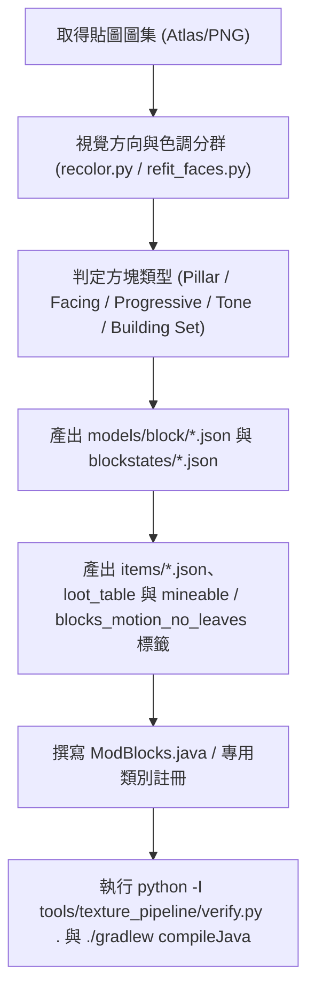

# The Sift (pysift) — 模組開發進度表、工作流程與技術規範

> **文件目的**：本文件供開發團隊與協同 AI 工具（如 Claude Code、Gemini 等）快速對齊專案現狀、遵循開發規範、接續未完成工作，避免環境配置衝突與命名不一致。

---

## 一、專案環境與技術規範 (Technical Specifications)

### 1.1 執行環境與依賴版本
- **遊戲版本 (Minecraft Version)**：`26.3`（基於最新 Snapshot / 預發行版開發）
- **Java 版本 (Java Toolchain)**：`Java 25`（嚴格配置，JDK 路徑通常位於 `~/.jdks/ms-25.0.4.1` 或系統 Java 25）
- **模組載入器 (Mod Loader)**：`Fabric Loader >= 0.19.5`
- **構建工具 (Loom)**：`Fabric Loom 1.18.4 (1.18-SNAPSHOT)`
- **映射表 (Mappings)**：**Mojang 官方映射 (Official Mojang Mappings)**
  - *注意：嚴格禁止混入 Fabric Yarn 映射（如禁止使用 `AbstractBlock.Settings`、`BlockSoundGroup`、`PillarBlock`，必須使用 `BlockBehaviour.Properties`、`SoundType`、`RotatedPillarBlock`）。*
- **核心庫依賴**：
  - `fabric-api`: `0.162.0+26.3`
  - `geckolib`: `com.geckolib:geckolib-fabric-26.3:5.5.7`（GeckoLib 5）

### 1.2 識別碼與路徑命名規範
| 項目 | 規範值 | 說明 |
| :--- | :--- | :--- |
| **Mod ID** | `pysift` | 全局統一命名空間，禁止混用 `sift` 或 `custom` |
| **Java 主套件** | `pryuan05.pysift` | 實體、方塊、物品之根套件路徑 |
| **主類別** | `pryuan05.pysift.PySift` | 實作 `ModInitializer` |
| **客戶端類別** | `pryuan05.pysift.PySiftClient` | 實作 `ClientModInitializer` |
| **資源路徑 (Assets)** | `src/main/resources/assets/pysift/` | 放置 blockstates, models, textures, lang 等 |
| **資料路徑 (Data)** | `src/main/resources/data/pysift/` | 放置 loot_table, recipes, tags 等 |
| **原版資料覆寫** | `src/main/resources/data/minecraft/` | 放置工具開採標籤 `tags/block/mineable/` |

### 1.3 現代 Minecraft (1.21.4+ / 26.3) 必備資源規範
1. **物品模型定義 (Modern Item Definitions)**：
   - 每個方塊物品或自訂物品，除了 `models/item/<name>.json` 之外，必須在 `assets/pysift/items/<name>.json` 建立現代定義，避免物品欄出現紫黑丟失模型：
   ```json
   {
     "model": {
       "type": "minecraft:model",
       "model": "pysift:item/<name>"
     }
   }
   ```
2. **掉落表目錄雙重相容**：
   - Minecraft 1.21+ 採用單數 `data/pysift/loot_table/blocks/`，為求保險需同時相容複數 `data/pysift/loot_tables/blocks/`。
3. **註冊鍵綁定 (ResourceKey Binding)**：
   - 在 Minecraft 26.3 中，方塊與物品註冊時必須透過 `.setId(blockKey)` 顯式設定鍵值，否則執行階段會拋出 `Identifier not set` 例外崩潰：
   ```java
   ResourceKey<Block> blockKey = ResourceKey.create(Registries.BLOCK, PySift.id(name));
   Block block = new Block(properties.setId(blockKey));
   Registry.register(BuiltInRegistries.BLOCK, blockKey, block);
   ```

---

## 二、目前開發進度全貌 (Progress Table)

| 系統模組 | 狀態 | 完成度 | 現狀摘要與檔案指針 |
| :--- | :---: | :---: | :--- |
| **基礎骨架 (Core)** | ✅ 完成 | 100% | Fabric 26.3 環境、生命週期初始化、混淆映射校驗皆已通過。 |
| **方塊系統與建材組 (Blocks)** | ✅ 完成 | 100% | 核心狀態重構已合併（PR #1, #2）；新增 38 組石材建材組（磚、浮雕磚、半磚、階梯、牆與切石機配方）、靈柳木建材組、植被與靈魂晶塊，共 461 個註冊方塊，通過 `verify.py` 零錯誤檢驗。 |
| **生物系統與戰鬥 AI (Entities & AI)** | 🟢 實作完成（待實機微調） | 95% | 24 款 Sift 生物（共 25 個類別）與 2 款投射物皆已實作專屬 AI、技能動畫與互動機制；包含 11 個通用技能 Goal（`entity/ai/`）與三隻 Boss 的二階段狂暴／援軍／守場機制（`BossMechanics.java`）。 |
| **物品與創造分頁 (Items & Tabs)** | ✅ 完成 | 100% | 24 款生怪蛋、`charoite`、`siftite_ingot`、`soul_antidote`（靈魂解藥）、`spirit_liquid_bucket`；創造分頁依世界生成使用與否拆分為 `pysift_blocks`（27 種核心生成方塊及其建材）與 `pysift_unused_blocks`（115 種未生成方塊），另設 `pysift_items`。 |
| **維度與地貌 (The Sift Dimension)** | 🟢 實作完成（待實機驗證） | 90% | `pysift:the_sift` 維度與 4 個自訂生態系（赤紅沉積峽谷、紫晶深板岩區、柳絮林地、琥珀沙丘）；平緩地形搭配淺池、圓形分層桌山（`StrataSpireFeature`）、Boss 競技場（`BossArenaFeature`）與巨型靈柳（`SoulWillowTrunkPlacer` / `SoulWillowFoliagePlacer` / `SoulWillowVineDecorator`）。 |
| **靈液與靈魂剝奪 (Fluid & Effects)** | 🟢 實作完成（待實機驗證） | 95% | `spirit_liquid` 流體與 `soul_deprivation` 效果；包含 80% 血量抽離、受傷觸發靈魂碎裂（鎖定最大生命上限）、靈魂解藥復原、幽匿風格視覺後處理（`SoulDeprivationVision`）與靈魂火愛心 HUD。 |
| **傳送門與開門儀式 (Portal)** | 🟢 實作完成（待實機驗證） | 90% | `sift_portal` 方塊與 `SiftPortalRitual`（強化深板岩旁吹山羊角召喚歌者，手持迴音碎片／靈魂沙／靈魂晶塊右鍵歌者共鳴開門），含跨方塊大畫布渲染器（`SiftPortalBlockEntityRenderer`）與 2 秒傳送過場動畫（`SiftPortalTransition`）。 |
| **進度循環 (Progression)** | 🟢 實作完成（待實機驗證；貼圖為臨時圖） | 90% | 第 1 階段：篩金石礦／紫龍晶簇、篩金石工具與盔甲（套裝減輕靈魂剝奪）、22 種生物掉落、三隻 Boss 的核心與碎片、篩靈祭壇與召喚印記（重新挑戰）、音波法杖／衝刺護符／重錘與覺醒升級、篩靈信標（鑲嵌胸甲的免疫光環）、10 個成就。程式在 `progression/`，資源由 `tools/progression/build_progression.py` 產生，貼圖已全部換成正式美術；目前的美術需求總目錄在 `art_requests/README.md`。 |
| **世界內容 (World Content)** | 🟢 實作完成（待實機驗證） | 85% | 第 2 階段：四種結構（地層神殿、深淵方尖碑、靈柳小屋、沙丘古墓，各有戰利品箱）、地下靈魂晶洞、各生態域環境粒子。結構由 `tools/worldgen/build_structures.py` 產生（26.3 結構檔調色盤用 `id`／`properties`），晶洞與粒子在 `build_the_sift.py`。生怪平衡待實機調整。 |
| **音效與粒子 (Audio/FX)** | 🟡 基礎完成 | 60% | 已實作靈魂光點與靈魂軌跡粒子（`ModParticles`）、各技能與儀式之原版音效組合；自訂專屬環境音檔與生物獨立音效待日後擴充。 |

---

## 三、模組架構與檔案索引 (Codebase Index)

### 3.1 Java 原始碼結構
```text
src/main/java/pryuan05/pysift/
├── PySift.java                        # 主模組入口，集中呼叫各子系統 register()
├── block/
│   ├── ModBlocks.java                 # 核心方塊、38 組建材組與 SIFT_PORTAL 註冊
│   ├── ModVegetation.java             # 生態系植被方塊註冊
│   ├── SoulWillowWood.java            # 靈柳木建材組（原木、木板、門、活板門、告示牌、書架等）
│   ├── SoulWillowVineBlock.java       # 靈柳垂藤邏輯
│   ├── SoulCrystal.java               # 靈魂晶塊方塊與物品
│   ├── SiftPortalBlock.java           # 篩靈界傳送門方塊、跨維度傳送與框架 BFS
│   ├── SiftPortalRitual.java          # 山羊角召喚歌者與共鳴開門儀式
│   ├── SiftStateBlock.java            # 動態狀態方塊建構器
│   ├── SiftStateProperties.java       # 自訂方塊狀態列舉（Tone, Host, Tint）
│   └── entity/                        # 方塊實體（SiftPortalBlockEntity）
├── fluid/
│   ├── ModFluids.java                 # 靈液（spirit_liquid）流體、方塊與桶註冊
│   └── SpiritFluid.java               # 靈液流動與接觸觸發靈魂剝奪邏輯
├── effect/
│   ├── ModEffects.java                # 靈魂剝奪（soul_deprivation）狀態效果
│   └── SoulBurn.java                  # 血量抽離、靈魂碎裂、解藥復原與資料同步附件
├── item/
│   ├── ModItems.java                  # 物品註冊、24 款生怪蛋、三創造模式分頁定義
│   └── SoulAntidoteItem.java          # 靈魂解藥物品邏輯
├── particle/
│   └── ModParticles.java              # 靈魂光點與軌跡粒子註冊
├── worldgen/
│   ├── SoulWillowTrunkPlacer.java     # 巨型靈柳扭曲樹幹生成器
│   ├── SoulWillowFoliagePlacer.java   # 巨型靈柳雲朵樹冠生成器
│   ├── SoulWillowVineDecorator.java   # 靈柳外圍垂藤裝飾器
│   ├── StrataSpireFeature.java        # 圓形分層地層桌山特徵
│   └── BossArenaFeature.java          # Boss 競技場結構生成與守場綁定
└── entity/
    ├── ModEntities.java               # 24 款生物與 2 款投射物註冊、屬性綁定
    ├── BossMechanics.java             # 三大 Boss 共用二階段狂暴、召喚援軍、脫戰回血與守場
    ├── PysiftGeoEntity.java           # GeckoLib 5 實體基底與技能動畫觸發封裝
    ├── PysiftMonsterEntity.java       # 敵對怪物基底類別
    ├── PysiftAnimalEntity.java        # 被動／友善生物基底類別
    ├── ai/                            # 11 個通用技能與戰術 AI Goal（砸地、音波、衝撞、共鳴環等）
    ├── projectile/                    # DartEntity（尖刺飛鏢）、ThrownRockEntity（投擲碎石）
    └── mob/                           # 24 款具體生物邏輯類別（共 25 個 class 含 PysiftSwarmEntity）
src/client/java/pryuan05/pysift/
├── PySiftClient.java                  # 客戶端入口，註冊實體／方塊實體渲染器、粒子與視覺效果
└── client/
    ├── PysiftUniversalGeoModel.java   # 通用動態路徑 GeckoLib 5 模型配接器
    ├── PysiftUniversalGeoRenderer.java# 通用動態渲染器（含發光層與死亡旋轉控制）
    ├── SlabberRenderer.java           # 泥板獸背部花朵渲染器
    ├── SoulDeprivationVision.java     # 靈魂剝奪之幽匿視覺後處理
    ├── SiftPortalTransition.java      # 傳送門過場動畫
    └── render/                        # SiftPortalBlockEntityRenderer 大畫布流光渲染器
```

### 3.2 資源結構現狀
- **生物資產（GeckoLib 5 標準路徑）**：
  - 幾何模型：`src/main/resources/assets/pysift/geckolib/models/entity/*.geo.json`
  - 動畫設定：`src/main/resources/assets/pysift/geckolib/animations/entity/*.animation.json`
  - 實體貼圖：`src/main/resources/assets/pysift/textures/entity/*.png`
- **方塊與世界生成資產**：
  - 存放於 `src/main/resources/assets/pysift/` 與 `src/main/resources/data/pysift/`（共 461 個註冊方塊，含建材組、切石配方、4 個生態系與 `the_sift` 維度配置）。

---

## 四、協同開發工作流程 (Development Pipelines)

### 4.1 方塊新增與重構流程


### 4.2 生物新增與動畫配接流程
1. **模型與動畫準備**：在 Blockbench 中匯出為 GeckoLib 5 規範之 `.geo.json` 與 `.animation.json`，放入 `assets/pysift/geckolib/models/entity/` 與 `assets/pysift/geckolib/animations/entity/`。
2. **實體邏輯實作**：
   - 繼承 `PysiftMonsterEntity`、`PysiftAnimalEntity` 或 `PysiftGeoEntity`。
   - 覆寫 `skillAnimations()`、`meleeAnimation()`、`hasDeathAnimation()` 並搭配 `entity/ai/` 下的 `TimedSkillGoal` 子類別觸發技能與動畫。
3. **註冊實體與生怪蛋**：
   - 在 `ModEntities.java` 宣告 `EntityType.Builder` 並加入 `FabricDefaultAttributeRegistry`。
   - 在 `ModItems.java` 註冊對應之 `SpawnEggItem`。
4. **客戶端渲染器註冊**：
   - 在 `PySiftClient.java` 中將新實體類型綁定至 `PysiftUniversalGeoRenderer`（或專用渲染器如 `SlabberRenderer`）。

---

## 4.5 第 1 階段：進度循環規格（Progression）

> 程式：`src/main/java/pryuan05/pysift/progression/`；資源：`python -I tools/progression/build_progression.py .`
> （先跑它，再跑 `tools/worldgen/build_the_sift.py`，因為礦石生成要用到新方塊）。臨時貼圖不會覆蓋使用者畫好的圖。

| 層級 | 內容 | 實作 |
| :-- | :-- | :-- |
| 礦石 | 篩金石礦：所有生態域地下虛黑岩 y -40～40（每區塊約 30 個）→ 粗篩金石 → 熔煉／高爐成篩金石錠；紫龍晶簇：紫晶區地表與洞穴地面 → 2–4 紫龍晶 | `ModProgression`、`build_the_sift.py` 的 `siftite_ore` / `charoite_clusters` |
| 生物掉落 | 22 種一般生物的掉落表；篩靈界敵對生物有機率掉靈魂精華（召喚印記材料），引信蠅掉引信粉 | `build_progression.py` 的 `MOB_DROPS` |
| 篩金石裝備 | 工具：耐久 800、速度 7、攻擊 +2.5；盔甲 2/7/5/2、韌性 1；穿滿四件時靈魂剝奪只抽到 0.5 倍血量 | `SiftiteGear`、`SoulWard` |
| Boss 掉落 | 每次必掉 1 顆核心（調和者核心／君王王冠／幽匿巨怪之心）＋ 2–4 碎片（共鳴音晶／君王羽刃／幽匿鱗片）＋靈魂精華、篩金石錠 | `BossRewards`、掉落表 |
| 重新挑戰 | 篩靈祭壇放在 Boss 競技場 48 格內，手持召喚印記右鍵重新召喚該競技場的 Boss（同種 Boss 還活著時不行） | `SiftAltarBlock`、`BossArenaSavedData` |
| Boss 武器 | 音波法杖：右鍵音爆（8 點、冷卻 3 秒）、左鍵連鎖 3 敵（各 3 點）＋靈魂剝奪；衝刺護符：二段衝刺＋留下玩家分身 10 秒；重錘：蓄力砸地擊飛＋幽匿藤蔓 2 秒後爆炸＋靈魂剝奪 | `SonicStaffItem`、`DashCharmItem`、`SculkHammerItem` |
| 覺醒 | 鍛造台：武器＋另外兩隻 Boss 的碎片 → 覺醒版（法杖連鎖 5、寬音爆；護符 3 段衝刺並傷害路徑敵人；重錘半徑 6、7 條藤蔓） | `smithing_transform` 配方、`pysift:awakened` 元件 |
| 終局 | 篩靈信標寶石（三核心＋6 紫龍晶）鑲嵌到任一胸甲（鍛造台）→ 穿著者 8 格內所有玩家免疫靈魂剝奪、已有的剝奪被淨化 | `SiftBeacon`、`pysift:sift_beacon` 元件 |
| 怪物版靈魂剝奪 | 受到傷害 +30%、每秒流失約 1.25 生命 | `SoulDeprivationDamageMixin`、`ModEffects` |
| 成就 | 進入篩靈界 → 靈液 → 解藥；篩金石 → 盔甲；擊敗三 Boss → 覺醒 → 篩靈信標 | `data/pysift/advancement/progression/` |
| 靈髓（Soulite） | 比獄髓更強：靈髓錠＝獄髓錠＋三種 Boss 碎片＋4 紫龍晶；鍛造台用靈髓升級模板（Boss 25% 掉落、結構寶箱、可複製）把獄髓裝備升級。工具耐久 2600／速度 10／攻擊 +5；盔甲 4/9/7/4、韌性 4。劍：每 3 下音波連鎖；斧：蓄滿力長出幽匿藤蔓；鎬鏟鋤：礦石 15% 掉靈魂精華；頭盔：敵人發光；胸甲：瀕死留分身＋速度；護腿：減擊退＋幽匿荊棘；靴子：免摔落、走在靈液上；整套免疫靈魂剝奪 | `SouliteGear`、`SouliteFluidWalkMixin` |

**需要多次挑戰的設計**：每次擊敗只掉一顆核心，三把武器各用掉一顆、篩靈信標再用三種各一顆 → 每隻 Boss 至少打兩次；覺醒需要另外兩隻 Boss 的碎片。

## 4.6 第 3 階段計畫（使用者選定 A → B → D）

| 項目 | 內容 | 狀態 / 實作 |
| :--- | :--- | :--- |
| A 靈魂羅盤 | 篩靈界右鍵：指向三隻 Boss 的競技場（還沒生成時改指向其生態域）或最近遺跡；蹲下右鍵切換。羅盤＋3 紫龍晶＋靈魂精華 | ✅ `SiftGuidance.SoulCompassItem`、`#pysift:soul_compass_targets` |
| A 回程符石 | 篩靈界按住 3 秒傳回主世界重生點；靈魂精華＋紫龍晶＋終界珍珠 → 2 個 | ✅ `SiftGuidance.HomewardStoneItem` |
| A 篩靈指南書 | 第一次進入篩靈界自動獲得（玩家附加資料 `received_guide`）；書＋紫龍晶可再合成。10 頁 | ✅ `SiftGuidance.guideBook()` |
| A0 八音開門儀式 | 遠古城市：山羊角召喚儀式歌者（固定不動）→ 迴音碎片 → 兩隻迴音傀儡擺 8 個共鳴唱片盒 → 放 8 張指定唱片（各有顏色光柱）→ 開門；唱片盒是鑰匙，打破即關門。篩靈界：靈魂晶塊框架＋迴音碎片開回程門。開發指令 `/pysift_ritual start/fill` | ✅ `SiftPortalRitual`、`ResonantJukeboxBlock`、`RitualDiscs`、`ResonantJukeboxRenderer` |
| B 靈莓叢 | 4 格內有靈液才會長（靈液澆灌），越熟越亮，熟了右鍵採 2～3 顆；生成在靈液池邊。靈莓可吃（10 秒靈魂守護） | ✅ `SiftFarming.SoulBerryBushBlock` |
| B 幽光菇 | 洞穴地面的發光小菇，暗處會慢慢蔓延；碗＋2 幽光菇＋靈莓 → 幽光菇燉湯（飽食 7＋45 秒回音視界） | ✅ `SiftFarming.GloomcapBlock` |
| B 靈魂釀造 | 原版釀造台（26.3 資料驅動配方）：粗製藥水＋靈莓 → 靈魂守護（免疫靈魂剝奪，3:00／8:00）；粗製藥水＋幽光菇 → 回音視界（32 格內敵人發光，並冒出只有自己看得到的幽匿粒子）；紅石延長，火藥／龍息轉噴濺與滯留 | ✅ `SiftFarming`、`data/pysift/recipe/brewing_*.json` |
| B 布魯布 | 馴服後像狼一樣幫忙打架（攻擊力 4）；會叼回 8 格內的掉落物放進主人背包（主人自己丟的不撿） | ✅ `BlubEntity` |
| B 泥板獸 | 騎乘與靈液行走：做過後依使用者要求拿掉 | ✖ 取消 |
| B 原住民聚落 | 使用者決定不做村民型聚落 | ✖ 取消 |
| D 世界再充實 | 地底生態域（晶洞、靈液河）、更多結構與大型地下遺跡、用未使用方塊做裝飾方塊 | 待做 |

## 4.6b 靈魂動力：靈魂紅石（2026-11-13 改版）

> 2026-11-13：靈魂動力和 Create 過分重疊，改成在原版紅石上拓展。下面這張表是現行的基礎系統；再下面一張表
> （Create 式的轉動）只在 `config/pysift.properties` 設定 `kinetic_addon=on` 時存在，程式在 `soulpower/kinetic/`。
> 裝了 Create 時的定位（在 Create 的傳動上疊加能力）寫在 `docs/CREATE_ADDON.md`，尚未實作。

| 項目 | 內容 | 實作 |
| :--- | :--- | :--- |
| 設定 | 靈魂訊號就是歌聲：活的赤紅幽匿脈把靈魂傳到遠處。原版紅石是「沒有靈魂的訊號」。遠古城市地下的紅石室是遠古人仿造失敗的版本（遠古殘頁其十、手記「靈魂導線」）。 | `tools/progression/build_codex.py` |
| 迴路 | 強度 0～15；引擎旁 15，每 2 格少 1 級（花費以半級計：相鄰 1，強度 = 15 − 花費 ÷ 2）。機器速度 = 32 × 強度 ÷ 15，負載 = impact × 32 × 強度 ÷ 15。容量 = 每台運轉中的引擎 256 SP。過載：靈魂訊號歸零，5 秒後 6 格內靈魂剝奪。 | `soulpower/SoulCircuit`、`SoulSignal`、`SoulConductor` |
| 靈魂導線 | 六向；`power`（對外的紅石強度）＋ `charged`（有沒有靈魂訊號）。對原版是訊號源；收拉桿、中繼器、比較器、紅石火把、紅石塊的訊號（不收紅石粉、不收隔著方塊的強充能）。原版訊號只驅動原版元件。三種外觀：赤紅／枯藍／灰。徒手可拆。 | `SoulConduitBlock` |
| 控制 | 機器貼著原版訊號：暫停、不計負載。引擎貼著原版訊號：關閉、燃料暫停。貼著的靈魂元件不算。 | `SoulSignal.externalRedstone` |
| 無線 | 只剩紫龍晶光束：不損耗，只從發射器到接收器。靈魂振波（和光束重疊）與靈脈節點（導線本來就能穿過岩層）已於 2026-11-13 移除。 | `SoulConductor.Relay`（`CharoiteBeamBlockEntity`） |
| 導線外觀 | 每面的接頭 none／wire／plug／low；強度存在方塊實體。伸向拉桿、按鈕等小元件的觸鬚與「包覆」（右鍵完整方塊，存在方塊實體 `Cover`，外框變完整方塊）由用戶端渲染。 | `SoulConduitBlock`、`client/soulpower/ConduitRenderer` |
| 歌者與元件（第二階段） | 歌者在導線 3 格內對著它唱 `SingerSongs.LINE`（篩網之歌＋三首曲子），期間 `SoulCircuit.feed` 讓那段導線成為來源（15、64 SP），唱完休息 600 tick；哀悼者哭的時候餵沒有靈魂的訊號。靈魂中繼器（`accepts`／`emits`／`boosts`，16 SP）、靈魂濾波器（`passes`）、靈魂音符盒（`RitualDiscs` 的八音）。 | `SingerEntity.tickLineSong`、`SoulRepeaterBlock`、`SoulFilterBlock`、`SoulNoteBlock` |
| 幽匿接點 | 催化體綻放時，貼著它的導線 10 秒內是來源（強度 15、32 SP）。迴路過載時，貼著導線的尖嘯體尖叫（不召喚監守者）。感測器的輸出是原版訊號。 | `SoulCircuit.charge`／`shriek` |
| 兩個求解器 | 機械層啟用時，方塊實體同時收到靈魂迴路與轉速網路的結果：只有一邊有動力源就聽那一邊，兩邊都有就聽負載重的那一邊；POWERED 由方塊實體決定。引擎的過載計時兩邊各算各的。 | `KineticBlockEntity.apply` |
| 測試 | `tools/progression/test_soul_redstone.py`（機械層關閉，60 項）；`test_soul_power.py`（`kinetic_addon=on`）。 | |

### 機械層（`kinetic_addon=on` 才有；2026-11-07，Create 式）

| 項目 | 內容 | 實作 |
| :--- | :--- | :--- |
| 網路 | 有正負號的轉速＋傳動比（同軸 ×1、相鄰小齒輪 ×-1、大↔小斜向 ×-2／×-1/2）；轉速衝突（兩條路不同速、兩台引擎不一致、超過 256 RPM）→ 全網停轉冒煙；負載 = impact × \|RPM\|；過載 5 秒 → 6 格內靈魂剝奪 | `soulpower/SoulNetwork`、`SoulKinetic`、`KineticBlockEntity`（每個方塊都有方塊實體，同步 Speed／Load） |
| 動力源 | 靈液引擎：32 RPM，每 RPM 8 SP（256 SP） | `SpiritEngineBlock(Entity)` |
| 傳動 | 傳動軸、靈魂齒輪、大靈魂齒輪、靈壓計（比較器 0～15） | `SoulShaftBlock`、`SoulCogBlock`、`SoulGaugeBlock` |
| 無線 | 振波（同唱片、16 格、羊毛擋、損耗 10%）；紫龍晶光束（32 格、稜鏡轉向、玻璃可穿、灼傷 2/秒、損耗 5%）；靈脈（16 格內整條是岩石、長出靈脈石、損耗 15%） | `SoulWaveBlock(Entity)`、`CharoiteBeam*`、`CharoitePrismBlock`、`SoulVeinNode*` |
| 機器 | 研磨機（impact 2，`pysift:soul_grinding`）；淨化篩（impact 3，8 格內藍幽匿 → 赤紅，`pysift:soul_sifting`，成就 `story/sifted`） | `SoulGrinderBlockEntity`、`SoulSifterBlockEntity` |
| 動畫 | Create 式部件模型（`SoulParts`，永不放置的方塊掛模型）由 `client/soulpower/SoulPowerRenderer` 依「遊戲時間 × 轉速」旋轉；齒輪奇偶格錯開半齒；過載抖動 | 資源 `tools/progression/build_soul_power.py`，預覽 `preview_soul_power.py`，伺服器測試 `test_soul_power.py` |
| 聲音 | 引擎每行程噗聲、研磨、篩、振波、過載、衝突 | `tools/audio/machines.py` |
| 靈液 | 靈液泵（impact 2，吸正前方源頭，4000 mB 槽）→ 靈液管（自動連接）→ 引擎（4000 mB 槽，燃料格空時每 1000 mB 燒一桶的時間）；只接一頭的管子漏液，下方泥土／沙變靈魂土 | `SpiritPumpBlock(Entity)`、`SpiritPipeBlock` |
| 控制與其他 | 齒輪箱（軸向四周四面互通，`transfer` 正方向 ×1／負方向 ×-1：轉 90°、對面反轉）；手搖曲柄（右鍵 32 RPM、每 RPM 3 SP = 96 SP，夠一台研磨機或淨化篩；過載時動作列提示）；離合器／換向器（紅石：放開正方向那一頭／正方向那一頭反轉，`SoulKinetic.transfer`）；風扇（氣流 = \|RPM\|÷4 格，反轉時吸；穿過靈魂火 → `pysift:soul_haunting`） | `SoulHandCrankBlock`、`SoulShiftBlock`、`SoulFanBlock(Entity)` |
| 共鳴靈陣 | 共鳴核心（impact 4）＋ 8 個共鳴台座（距 3 格），配方寫在 `ResonanceCoreBlockEntity.RECIPES`（迴音碎片、紫龍晶、強化深板岩、8 張共鳴唱片複製）；核心 8 格內研磨機／淨化篩 ×1.5 | `ResonanceCoreBlock(Entity)`、`ResonancePedestalBlock`、`client/soulpower/PedestalRenderer` |
| 鑽頭 | 靈魂鑽頭（impact 2）：工作量 = 硬度 × 30 tick ÷ (\|RPM\|/32)，掉落物以鐵鎬計算，`#wither_immune` 鑽不動，前方生物 3 傷害／0.5 秒 | `SoulDrillBlock` |
| 待做 | 專屬貼圖（`art_requests/soul_power_todo.md`） | |

## 4.7 世界觀：不是幽匿感染主世界，是主世界感染了幽匿（2026-11-03 改版）

> 之後新增的內容（結構、生物、道具、成就文字、指南書）都以這一節為依據。
> 2026-11-03 使用者依一篇玩家理論改寫（取代 2026-10-27 的「方向 2」）：幽匿是隙浮原生的生命、監守者與哀悼者是屍化的
> 隙浮生物、遠古人放錯共鳴唱片盒才釀成災難。

**核心：** 隙浮明亮、充滿生命，靠靈液（靈魂流體）運轉；主世界的空氣裡沒有靈魂。隙浮的生命一旦離開靈液就會「餓」，
慢慢腐爛、屍化（就像豬布林到了主世界會變成殭屍化豬布林）。主世界的深暗之域不是幽匿入侵的前線，而是一群困在異鄉、
正在死去的隙浮生命。

| 元素 | 設定 |
| :--- | :--- |
| **隙浮（The Sift）** | 靈魂之間的「篩網」，靈液流過的地方萬物都活著、會唱歌。原住民歌者沒有眼睛，靠歌聲交流，也用歌聲維持篩網。 |
| **靈液（spirit_liquid）** | 隙浮生命的血，讓幽匿保持紅色、讓歌者保有毛髮與歌聲。主世界的身體承受不了這麼濃的靈魂，碰到就會被剝奪靈魂（`soul_deprivation`）。 |
| **幽匿** | **隙浮原生的生命**。健康的幽匿是紅色的（赤紅幽匿、熔脈裡的靈液色），會「聽」，因為隙浮的一切都靠聲音溝通。缺了靈液就枯死變成深藍色：主世界深暗之域的幽匿，就是逃出來後慢慢腐爛的赤紅幽匿。隙浮裡靈液乾涸的地方也有深色、枯死的幽匿。 |
| **遠古城市** | 遠古文明想打開通往隙浮的門。開門要讓 8 個共鳴唱片盒依正確順序奏出八音，但他們**把唱片放錯了盒子**，奏出走調的旋律（玩家理論：1 3 4 6 5 2 4 8，正確是 1 3 7 6 5 2 4 8）。門被撕開，幽匿與一位歌者一起衝進主世界，遠古人全數死亡。 |
| **哀悼者（Mourner）** | **屍化的歌者**。那位被捲進主世界的歌者，用倒著唱的旋律把門關上，從此困在沒有靈魂的主世界，毛髮脫落、哭著唱歌，遠古人的陶片上把它刻成「哀悼者」。哀悼者之於歌者，就像殭屍化豬布林之於豬布林。 |
| **強化深板岩** | 門關上後，門框用**遠古人的骨頭**加固，所以強化深板岩無法開採。現在的門框上沒有加固，代表封印已經被拆開過。 |
| **監守者** | **屍化的隙浮生物**，和歌者是近親。在隙浮時全身覆毛、活生生的；困在主世界後餓到皮毛融落、露出骨頭，只能靠胸口吞下的靈魂（遠古人的靈魂）苟活，所以一直在哀嚎。幽匿把它們留下來當作守門的保全：門是用聲音打開的，所以監守者對任何聲音暴怒。 |
| **裂縫** | 那次錯誤的開門在兩界邊界留下裂縫。野外的小型裂隙傳送門（`wild_rift`）就是裂縫：主世界沒有靈魂的空氣從這裡**倒灌進隙浮**，讓附近的赤紅幽匿腐爛變藍，這才是真正的「感染」。 |
| **幽匿巨怪** | 被倒灌的主世界空氣腐化最深的一團幽匿，是隙浮這一側腐爛的核心（最終 Boss）。 |
| **回音窟（echo_den）** | （2026-11-06 使用者定案：合唱聖所＋傀儡誕生地＋監守者守衛）地底的**歌者合唱聖所**。歌者在圓形劇場齊唱正確的八音，替篩網「調音」，八音的正確順序就是在這裡一代代傳下來的。歌聲在晶洞的晶體裡反覆回響，回音凝結成**迴音傀儡**：傀儡是「有了身體的歌聲」，所以一出生就跟著歌者，替歌者搬共鳴唱片盒、送靈魂晶（`EchoGolemEntity.GiveCrystalToSingerGoal`）。入口與寶庫由**健康的監守者（隙浮守衛）**看守：它們是歌者的近親，全身覆毛、靠聽覺巡守，聽到歌聲就安靜，聽到陌生的聲響就醒來驅趕入侵者。主世界那批對任何聲音暴怒的監守者，就是當年跟著門一起被留在異鄉、失去歌聲的守衛。 |

**玩法方向（待逐步實作）**
- ✅ 八音儀式放錯唱片：門會閃爍、走調，接著爆出一陣深色幽匿與哀悼者的歌聲（重現遠古城市的災難），唱片全部彈出（`SiftPortalRitual.tearOpen`，測試指令 `/pysift_ritual fill wrong`）。
- ✅ 屍化：歌者在主世界約 5 分鐘、6 格內沒有靈魂晶塊或靈液，就變成哀悼者（`SingerEntity.tickHollowing`，存檔欄位 `OverworldTicks`）；哀悼者泡靈液 10 秒變回歌者（`MournerEntity`）。哀悼者也在深暗之域稀有生成。
- ✅ 治癒監守者：泡靈液 15 秒或待在隙浮 30 秒，變成隙浮守衛（`WardenCure`、`SiftWardenEntity`，沿用原版模型，貼圖 `tools/models/build_sift_warden.py`）。餵迴音碎片會跟隨。只有餓壞的監守者、哀悼者把靈液當食物吸收、不受傷（`#pysift:soul_starved`）；健康的歌者等原住民會吸收太多靈魂而受傷，剛治癒的有 10 秒爬出池子（實體標籤 `pysift_reborn`）。
- ✅ 淨化與篩：靈魂淨化篩（靈魂動力）把 8 格內腐爛的藍色幽匿篩回赤紅幽匿（`SoulSifterBlockEntity`，見 4.6b）。
- ✅ 歌聲的線路：靈魂導線是活的赤紅幽匿脈，靈魂訊號就是歌聲；原版紅石是沒有靈魂的訊號。遠古殘頁其十〈不會唱歌的線〉
  解釋遠古城市地下的紅石室（`AncientPages`，遠古城市箱子，不算在「完整的故事」的八張裡）。見 4.6b。
- ✅（視覺）赤紅幽匿（`red_sculk`、`red_sculk_vein`，靈液池邊）與裂隙門周圍的紅→藍腐爛帶（`WildRiftFeature.rotHalo`）。
- ✅ 裂縫：10 格內有隙浮傳送門的赤紅幽匿會隨機刻腐爛成藍色；擊敗幽匿巨怪後世界記下「腐爛之心已除」，藍幽匿慢慢變回紅色（`RotSpread`，測試指令 `/pysift_rot stilled <true|false>`）。
- ✅ 歌者與監守者的呼應：24 格內有監守者時，歌者發抖、倒唱八音（`SingerSongs.MOURNING`），監守者平靜 30 秒（`WardenSoothing`、`WardenMixin`）。
- ✅ 文字細節：《隙浮手記》（Modonomicon 書 `pysift:sift_codex`，`tools/progression/build_codex.py`）、8 張遠古殘頁（`AncientPages.java`，遠古城市／隙浮遺跡／幽匿巨怪）、強化深板岩與回響碎片的說明欄，都從這一節取材。4 種遠古陶器碎片（門扉、歌者、親族、八音，`AncientPages.SHERDS`）。故事成就 `story/*` 與相關資源由 `tools/progression/build_story.py` 產生。
- ✅ 第二部（故事道具與終章）：隙浮守衛能力（聆聽、守護、親族、治癒腐爛）；哀悼號角、八音陶片提示、封印石（第七幕，`RotSpread.seal`）、
  搖籃曲香爐（`LullabyCenserBlock`）、隙浮之心、遠古編年史（`StoryItems`、`AncientPages`）；終章「回家」（`Homecoming`：
  腐爛已止息＋歌者＋隙浮守衛，在強化深板岩門框前吹號角；之後在隙浮重逢，計數存在 `RotSpread.State.homeward`）。

---

## 五、待辦與後續驗收任務 (Pending Tasks)

1. **遊戲內實機驗證 (In-Game Verification)**：
   - 進入測試世界檢查：`pysift:the_sift` 維度平緩地形與桌山密度、巨型靈柳樹葉不腐爛與外圍垂藤密度、傳送門開門儀式與 2 秒過場動畫、靈液與靈魂剝奪視覺效果。
   - 測試 24 款生物與 3 隻 Boss 在競技場中的戰鬥數值、碰撞箱與動畫流暢度。
2. **生態系尺度評估 (Biome Spacing)**：
   - 目前生態系間距約 800–2,300 格，視實機探索體驗決定是否在 `tools/worldgen/build_the_sift.py` 縮小生物群系尺度。
3. **專屬音效與細節打磨 (Audio & Polish)**：
   - 視需求為主要生物與環境補充自訂音效資源。

---

## 六、常用除錯與驗證指令

```powershell
# 1. 執行方塊資源、標籤與貼圖一致性自動檢驗
python -I tools/texture_pipeline/verify.py .

# 2. 編譯主程式與客戶端 Java 程式碼（快速檢查型別與語法）
.\gradlew.bat compileJava compileClientJava

# 3. 完整建置模組 Jar
.\gradlew.bat build -x test

# 4. 啟動開發者測試客戶端
.\gradlew.bat runClient
```
