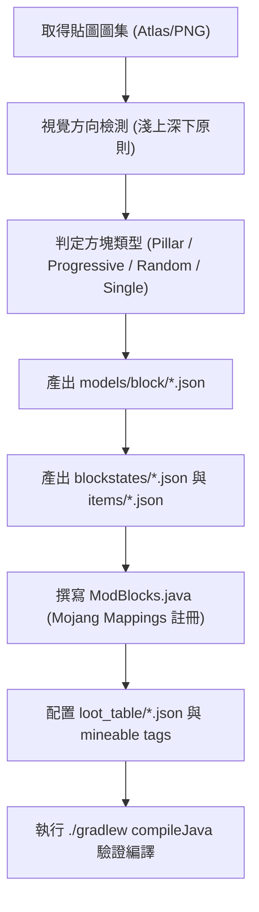

# The Sift (pysift) — 模組開發進度表、工作流程與技術規範

> **文件目的**：本文件供開發團隊與協同 AI 工具（如 Claude Code、Gemini 等）快速對齊專案現狀、遵循開發規範、接續未完成工作，避免環境配置衝突與命名不一致。

---

## 一、專案環境與技術規範 (Technical Specifications)

### 1.1 執行環境與依賴版本
- **遊戲版本 (Minecraft Version)**：`26.3`（基於最新 Snapshot / 預發行版開發）
- **Java 版本 (Java Toolchain)**：`Java 25`（嚴格配置，JDK 路徑通常位於 `~/.jdks/ms-25.0.4.1` 或系統 Java 25）
- **模組載入器 (Mod Loader)**：`Fabric Loader >= 0.19.5`
- **構建工具 (Loom)**：`Fabric Loom 1.18.4 (1.18-SNAPSHOT)`
- **映射表 (Mappings)**：**Mojang 官方映射 (Official Mojang Mappings)**
  - *注意：嚴格禁止混入 Fabric Yarn 映射（如禁止使用 `AbstractBlock.Settings`、`BlockSoundGroup`、`PillarBlock`，必須使用 `BlockBehaviour.Properties`、`SoundType`、`RotatedPillarBlock`）。*
- **核心庫依賴**：
  - `fabric-api`: `0.162.0+26.3`
  - `geckolib`: `com.geckolib:geckolib-fabric-26.3:5.5.7`（GeckoLib 5）

### 1.2 識別碼與路徑命名規範
| 項目 | 規範值 | 說明 |
| :--- | :--- | :--- |
| **Mod ID** | `pysift` | 全局統一命名空間，禁止混用 `sift` 或 `custom` |
| **Java 主套件** | `pryuan05.pysift` | 實體、方塊、物品之根套件路徑 |
| **主類別** | `pryuan05.pysift.PySift` | 實作 `ModInitializer` |
| **客戶端類別** | `pryuan05.pysift.PySiftClient` | 實作 `ClientModInitializer` |
| **資源路徑 (Assets)** | `src/main/resources/assets/pysift/` | 放置 blockstates, models, textures, lang 等 |
| **資料路徑 (Data)** | `src/main/resources/data/pysift/` | 放置 loot_table, recipes, tags 等 |
| **原版資料覆寫** | `src/main/resources/data/minecraft/` | 放置工具開採標籤 `tags/block/mineable/` |

### 1.3 現代 Minecraft (1.21.4+ / 26.3) 必備資源規範
1. **物品模型定義 (Modern Item Definitions)**：
   - 每個方塊物品或自訂物品，除了 `models/item/<name>.json` 之外，必須在 `assets/pysift/items/<name>.json` 建立現代定義，避免物品欄出現紫黑丟失模型：
   ```json
   {
     "model": {
       "type": "minecraft:model",
       "model": "pysift:item/<name>"
     }
   }
   ```
2. **掉落表目錄雙重相容**：
   - Minecraft 1.21+ 採用單數 `data/pysift/loot_table/blocks/`，為求保險需同時相容複數 `data/pysift/loot_tables/blocks/`。
3. **註冊鍵綁定 (ResourceKey Binding)**：
   - 在 Minecraft 26.3 中，方塊與物品註冊時必須透過 `.setId(blockKey)` 顯式設定鍵值，否則執行階段會拋出 `Identifier not set` 例外崩潰：
   ```java
   ResourceKey<Block> blockKey = ResourceKey.create(Registries.BLOCK, PySift.id(name));
   Block block = new Block(properties.setId(blockKey));
   Registry.register(BuiltInRegistries.BLOCK, blockKey, block);
   ```

---

## 二、目前開發進度全貌 (Progress Table)

| 系統模組 | 狀態 | 完成度 | 現狀摘要與檔案指針 |
| :--- | :---: | :---: | :--- |
| **基礎骨架 (Core)** | ✅ 完成 | 100% | Fabric 26.3 環境、生命週期初始化、混淆映射校驗皆已通過。 |
| **生物系統 (Entities)** | 🟡 基礎完成 | 80% | 24 款 Sift 獨特生物皆已註冊、GeckoLib 5 骨骼模型 (`.geo.json`) 與動畫綁定完成；待補強進階 AI Goal 與專屬技能。 |
| **物品與材料 (Items)** | 🟡 基礎完成 | 85% | 24 款生怪蛋、`charoite` (紫龍晶系列)、`siftite_ingot` (篩金石錠)、雙創造模式分頁 (`pysift_blocks`, `pysift_items`)。 |
| **方塊系統 (Blocks) — 原始分支** | 🟢 穩定可用 | 100% | 295 款獨立編號方塊在主程式庫正常運作，包含柱體原木、覆蓋石與地層岩。 |
| **方塊系統 (Blocks) — 視覺整合** | 🟢 獨立交付 | 100% | 已於獨立目錄 [`sift_visual_corrected/`](file:///c:/Users/hoeyl/Documents/Minecraft%20Modding/the-sift-pryuan-version/sift_visual_corrected/) 完成 81 款家族整合、9 張貼圖垂直糾偏、單調漸進狀態重排，並通過自動化檢驗。 |
| **戰鬥與行為 AI** | 🔴 待實作 | 20% | 生物目前僅具備基本移動、看視或被動攻擊行為，待建立技能邏輯與彈射物。 |
| **維度與地貌 (Dimension)** | 🔴 待實作 | 10% | The Sift 維度世界生成器、自訂生物群系 (Biomes)、地層沉積規則尚未掛載。 |
| **音效與粒子 (Audio/FX)** | 🔴 待實作 | 15% | 目前使用原版音效群（石頭、深板岩、木頭、泥土），專屬環境音與生物音效待補。 |

---

## 三、模組架構與檔案索引 (Codebase Index)

### 3.1 Java 原始碼結構
```text
src/main/java/pryuan05/pysift/
├── PySift.java                        # 主模組入口，集中呼叫各模組 register()
├── block/
│   └── ModBlocks.java                 # 方塊註冊主類別，維護 ALL_BLOCKS 清單
├── item/
│   └── ModItems.java                  # 物品註冊、生怪蛋清單、創造模式分頁定義
├── entity/
│   ├── ModEntities.java               # 24 款實體類型註冊、屬性綁定 (Attributes)
│   ├── PysiftGeoEntity.java           # GeckoLib 5 實體抽象介面
│   ├── PysiftMonsterEntity.java       # 怪物基底類別
│   ├── PysiftAnimalEntity.java        # 動物/被動生物基底類別
│   └── mob/                           # 24 款具體生物邏輯類別
│       ├── BlubEntity.java
│       ├── EchoGolemEntity.java
│       ├── SculptMonstrosityEntity.java
│       └── ... (其餘 21 款)
src/client/java/pryuan05/pysift/
├── PySiftClient.java                  # 客戶端入口，註冊 GeckoLib EntityRenderer
└── client/
    ├── PysiftUniversalGeoModel.java   # 通用動態路徑 GeckoLib 5 模型配接器
    └── PysiftUniversalGeoRenderer.java# 通用動態渲染器
```

### 3.2 資源結構現狀
- **生物資產**：
  - 幾何模型：`src/main/resources/assets/pysift/geo/entity/*.geo.json`（共 24 款）
  - 動畫設定：`src/main/resources/assets/pysift/animations/entity/*.animation.json`（共 24 款）
  - 實體貼圖：`src/main/resources/assets/pysift/textures/entity/*.png`
- **現行方塊資產 (主分支)**：
  - 存放於 `src/main/resources/assets/pysift/`（295 款方塊各自具備獨立 blockstates 與模型）。
- **校正後方塊資產 (交付與整併候選)**：
  - 存放於專案根目錄 [`sift_visual_corrected/`](file:///c:/Users/hoeyl/Documents/Minecraft%20Modding/the-sift-pryuan-version/sift_visual_corrected/)，內含 81 款整合 Blockstates、299 款模型、343 張校正貼圖及 5 份對照報告。

---

## 四、協同開發工作流程 (Development Pipelines)

### 4.1 方塊新增與重構流程


### 4.2 生物新增與動畫配接流程
1. **模型與動畫準備**：在 Blockbench 中匯出為 GeckoLib 5 規範之 `.geo.json` 與 `.animation.json`，放入 `assets/pysift/geo/entity/` 與 `animations/entity/`。
2. **實體邏輯實作**：
   - 繼承 `PysiftMonsterEntity` 或 `PysiftAnimalEntity`。
   - 實作 `GeoEntity` 介面，註冊動畫控制器（`idle`, `walk`, `attack` 等）。
3. **註冊實體與生怪蛋**：
   - 在 `ModEntities.java` 宣告 `EntityType.Builder` 並加入 `FabricDefaultAttributeRegistry`。
   - 在 `ModItems.java` 註冊對應之 `SpawnEggItem`。
4. **客戶端渲染器註冊**：
   - 在 `PySiftClient.java` 中將新實體類型綁定至 `PysiftUniversalGeoRenderer`。

---

## 五、Claude Code 協同工作指引與待辦任務 (Tasks for Claude Code)

### 優先任務清單 (Priority Roadmap)

#### 1. 【方塊系統】決定整合方案並合併資源
- **現狀**：主代碼目前使用 295 款獨立方塊；而 [`sift_visual_corrected/`](file:///c:/Users/hoeyl/Documents/Minecraft%20Modding/the-sift-pryuan-version/sift_visual_corrected/) 已就緒 81 款核心方塊的解決方案。
- **Claude Code 待辦**：
  - 與使用者溝通是否採納「81 款核心家族方案」（減少 72% Registry 佔用，隨機變體自然分佈，物品欄乾淨）。
  - 若採納，執行腳本將 `sift_visual_corrected/assets/sift/` 複製到 `src/main/resources/assets/pysift/`，並同步替換 `ModBlocks.java`。

#### 2. 【生物系統】進階 AI 與攻擊機制實作
- **現狀**：目前 24 款生物已具有模型與渲染，但行為多為空白或原版預設。
- **Claude Code 待辦**：
  - 為主要 Boss / 菁英怪（例如 `SculkMonstrosity`、`EchoGolem`、`Harmonizer`、`Monarch`）實作專屬攻擊目標、近戰砸地與遠程音波攻擊邏輯。
  - 綁定實體受到攻擊與釋放技能時觸發對應的 GeckoLib 動畫狀態。

#### 3. 【維度系統】The Sift 維度建立
- **Claude Code 待辦**：
  - 建立 `data/pysift/dimension/the_sift.json` 與 `dimension_type/the_sift.json`。
  - 設計自訂 Biomes（如赤紅沉積地層區、紫晶深板岩區、林地腐殖帶），引用上述方塊填入地表與地下地層。

---

## 六、常用除錯與驗證指令

```powershell
# 1. 執行資產與模型自動校驗
python sift_visual_corrected/scripts/validate_assets.py

# 2. 僅編譯 Java 程式碼（快速檢查型別與語法）
.\gradlew.bat compileJava

# 3. 完整建置模組 Jar
.\gradlew.bat build -x test

# 4. 啟動開發者測試客戶端
.\gradlew.bat runClient
```
