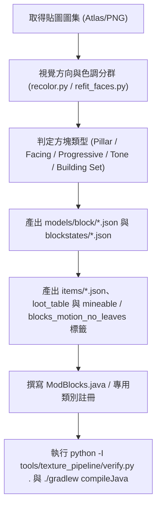

# The Sift (pysift) — 模組開發進度表、工作流程與技術規範

> **文件目的**：本文件供開發團隊與協同 AI 工具（如 Claude Code、Gemini 等）快速對齊專案現狀、遵循開發規範、接續未完成工作，避免環境配置衝突與命名不一致。

---

## 一、專案環境與技術規範 (Technical Specifications)

### 1.1 執行環境與依賴版本
- **遊戲版本 (Minecraft Version)**：`26.3`（基於最新 Snapshot / 預發行版開發）
- **Java 版本 (Java Toolchain)**：`Java 25`（嚴格配置，JDK 路徑通常位於 `~/.jdks/ms-25.0.4.1` 或系統 Java 25）
- **模組載入器 (Mod Loader)**：`Fabric Loader >= 0.19.5`
- **構建工具 (Loom)**：`Fabric Loom 1.18.4 (1.18-SNAPSHOT)`
- **映射表 (Mappings)**：**Mojang 官方映射 (Official Mojang Mappings)**
  - *注意：嚴格禁止混入 Fabric Yarn 映射（如禁止使用 `AbstractBlock.Settings`、`BlockSoundGroup`、`PillarBlock`，必須使用 `BlockBehaviour.Properties`、`SoundType`、`RotatedPillarBlock`）。*
- **核心庫依賴**：
  - `fabric-api`: `0.162.0+26.3`
  - `geckolib`: `com.geckolib:geckolib-fabric-26.3:5.5.7`（GeckoLib 5）

### 1.2 識別碼與路徑命名規範
| 項目 | 規範值 | 說明 |
| :--- | :--- | :--- |
| **Mod ID** | `pysift` | 全局統一命名空間，禁止混用 `sift` 或 `custom` |
| **Java 主套件** | `pryuan05.pysift` | 實體、方塊、物品之根套件路徑 |
| **主類別** | `pryuan05.pysift.PySift` | 實作 `ModInitializer` |
| **客戶端類別** | `pryuan05.pysift.PySiftClient` | 實作 `ClientModInitializer` |
| **資源路徑 (Assets)** | `src/main/resources/assets/pysift/` | 放置 blockstates, models, textures, lang 等 |
| **資料路徑 (Data)** | `src/main/resources/data/pysift/` | 放置 loot_table, recipes, tags 等 |
| **原版資料覆寫** | `src/main/resources/data/minecraft/` | 放置工具開採標籤 `tags/block/mineable/` |

### 1.3 現代 Minecraft (1.21.4+ / 26.3) 必備資源規範
1. **物品模型定義 (Modern Item Definitions)**：
   - 每個方塊物品或自訂物品，除了 `models/item/<name>.json` 之外，必須在 `assets/pysift/items/<name>.json` 建立現代定義，避免物品欄出現紫黑丟失模型：
   ```json
   {
     "model": {
       "type": "minecraft:model",
       "model": "pysift:item/<name>"
     }
   }
   ```
2. **掉落表目錄雙重相容**：
   - Minecraft 1.21+ 採用單數 `data/pysift/loot_table/blocks/`，為求保險需同時相容複數 `data/pysift/loot_tables/blocks/`。
3. **註冊鍵綁定 (ResourceKey Binding)**：
   - 在 Minecraft 26.3 中，方塊與物品註冊時必須透過 `.setId(blockKey)` 顯式設定鍵值，否則執行階段會拋出 `Identifier not set` 例外崩潰：
   ```java
   ResourceKey<Block> blockKey = ResourceKey.create(Registries.BLOCK, PySift.id(name));
   Block block = new Block(properties.setId(blockKey));
   Registry.register(BuiltInRegistries.BLOCK, blockKey, block);
   ```

---

## 二、目前開發進度全貌 (Progress Table)

| 系統模組 | 狀態 | 完成度 | 現狀摘要與檔案指針 |
| :--- | :---: | :---: | :--- |
| **基礎骨架 (Core)** | ✅ 完成 | 100% | Fabric 26.3 環境、生命週期初始化、混淆映射校驗皆已通過。 |
| **方塊系統與建材組 (Blocks)** | ✅ 完成 | 100% | 核心狀態重構已合併（PR #1, #2）；新增 38 組石材建材組（磚、浮雕磚、半磚、階梯、牆與切石機配方）、靈柳木建材組、植被與靈魂晶塊，共 461 個註冊方塊，通過 `verify.py` 零錯誤檢驗。 |
| **生物系統與戰鬥 AI (Entities & AI)** | 🟢 實作完成（待實機微調） | 95% | 24 款 Sift 生物（共 25 個類別）與 2 款投射物皆已實作專屬 AI、技能動畫與互動機制；包含 11 個通用技能 Goal（`entity/ai/`）與三隻 Boss 的二階段狂暴／援軍／守場機制（`BossMechanics.java`）。 |
| **物品與創造分頁 (Items & Tabs)** | ✅ 完成 | 100% | 24 款生怪蛋、`charoite`、`siftite_ingot`、`soul_antidote`（靈魂解藥）、`spirit_liquid_bucket`；創造分頁依世界生成使用與否拆分為 `pysift_blocks`（27 種核心生成方塊及其建材）與 `pysift_unused_blocks`（115 種未生成方塊），另設 `pysift_items`。 |
| **維度與地貌 (The Sift Dimension)** | 🟢 實作完成（待實機驗證） | 90% | `pysift:the_sift` 維度與 4 個自訂生態系（赤紅沉積峽谷、紫晶深板岩區、柳絮林地、琥珀沙丘）；平緩地形搭配淺池、圓形分層桌山（`StrataSpireFeature`）、Boss 競技場（`BossArenaFeature`）與巨型靈柳（`SoulWillowTrunkPlacer` / `SoulWillowFoliagePlacer` / `SoulWillowVineDecorator`）。 |
| **靈液與靈魂剝奪 (Fluid & Effects)** | 🟢 實作完成（待實機驗證） | 95% | `spirit_liquid` 流體與 `soul_deprivation` 效果；包含 80% 血量抽離、受傷觸發靈魂碎裂（鎖定最大生命上限）、靈魂解藥復原、幽匿風格視覺後處理（`SoulDeprivationVision`）與靈魂火愛心 HUD。 |
| **傳送門與開門儀式 (Portal)** | 🟢 實作完成（待實機驗證） | 90% | `sift_portal` 方塊與 `SiftPortalRitual`（強化深板岩旁吹山羊角召喚歌者，手持迴音碎片／靈魂沙／靈魂晶塊右鍵歌者共鳴開門），含跨方塊大畫布渲染器（`SiftPortalBlockEntityRenderer`）與 2 秒傳送過場動畫（`SiftPortalTransition`）。 |
| **音效與粒子 (Audio/FX)** | 🟡 基礎完成 | 60% | 已實作靈魂光點與靈魂軌跡粒子（`ModParticles`）、各技能與儀式之原版音效組合；自訂專屬環境音檔與生物獨立音效待日後擴充。 |

---

## 三、模組架構與檔案索引 (Codebase Index)

### 3.1 Java 原始碼結構
```text
src/main/java/pryuan05/pysift/
├── PySift.java                        # 主模組入口，集中呼叫各子系統 register()
├── block/
│   ├── ModBlocks.java                 # 核心方塊、38 組建材組與 SIFT_PORTAL 註冊
│   ├── ModVegetation.java             # 生態系植被方塊註冊
│   ├── SoulWillowWood.java            # 靈柳木建材組（原木、木板、門、活板門、告示牌、書架等）
│   ├── SoulWillowVineBlock.java       # 靈柳垂藤邏輯
│   ├── SoulCrystal.java               # 靈魂晶塊方塊與物品
│   ├── SiftPortalBlock.java           # 篩靈界傳送門方塊、跨維度傳送與框架 BFS
│   ├── SiftPortalRitual.java          # 山羊角召喚歌者與共鳴開門儀式
│   ├── SiftStateBlock.java            # 動態狀態方塊建構器
│   ├── SiftStateProperties.java       # 自訂方塊狀態列舉（Tone, Host, Tint）
│   └── entity/                        # 方塊實體（SiftPortalBlockEntity）
├── fluid/
│   ├── ModFluids.java                 # 靈液（spirit_liquid）流體、方塊與桶註冊
│   └── SpiritFluid.java               # 靈液流動與接觸觸發靈魂剝奪邏輯
├── effect/
│   ├── ModEffects.java                # 靈魂剝奪（soul_deprivation）狀態效果
│   └── SoulBurn.java                  # 血量抽離、靈魂碎裂、解藥復原與資料同步附件
├── item/
│   ├── ModItems.java                  # 物品註冊、24 款生怪蛋、三創造模式分頁定義
│   └── SoulAntidoteItem.java          # 靈魂解藥物品邏輯
├── particle/
│   └── ModParticles.java              # 靈魂光點與軌跡粒子註冊
├── worldgen/
│   ├── SoulWillowTrunkPlacer.java     # 巨型靈柳扭曲樹幹生成器
│   ├── SoulWillowFoliagePlacer.java   # 巨型靈柳雲朵樹冠生成器
│   ├── SoulWillowVineDecorator.java   # 靈柳外圍垂藤裝飾器
│   ├── StrataSpireFeature.java        # 圓形分層地層桌山特徵
│   └── BossArenaFeature.java          # Boss 競技場結構生成與守場綁定
└── entity/
    ├── ModEntities.java               # 24 款生物與 2 款投射物註冊、屬性綁定
    ├── BossMechanics.java             # 三大 Boss 共用二階段狂暴、召喚援軍、脫戰回血與守場
    ├── PysiftGeoEntity.java           # GeckoLib 5 實體基底與技能動畫觸發封裝
    ├── PysiftMonsterEntity.java       # 敵對怪物基底類別
    ├── PysiftAnimalEntity.java        # 被動／友善生物基底類別
    ├── ai/                            # 11 個通用技能與戰術 AI Goal（砸地、音波、衝撞、共鳴環等）
    ├── projectile/                    # DartEntity（尖刺飛鏢）、ThrownRockEntity（投擲碎石）
    └── mob/                           # 24 款具體生物邏輯類別（共 25 個 class 含 PysiftSwarmEntity）
src/client/java/pryuan05/pysift/
├── PySiftClient.java                  # 客戶端入口，註冊實體／方塊實體渲染器、粒子與視覺效果
└── client/
    ├── PysiftUniversalGeoModel.java   # 通用動態路徑 GeckoLib 5 模型配接器
    ├── PysiftUniversalGeoRenderer.java# 通用動態渲染器（含發光層與死亡旋轉控制）
    ├── SlabberRenderer.java           # 泥板獸背部花朵渲染器
    ├── SoulDeprivationVision.java     # 靈魂剝奪之幽匿視覺後處理
    ├── SiftPortalTransition.java      # 傳送門過場動畫
    └── render/                        # SiftPortalBlockEntityRenderer 大畫布流光渲染器
```

### 3.2 資源結構現狀
- **生物資產（GeckoLib 5 標準路徑）**：
  - 幾何模型：`src/main/resources/assets/pysift/geckolib/models/entity/*.geo.json`
  - 動畫設定：`src/main/resources/assets/pysift/geckolib/animations/entity/*.animation.json`
  - 實體貼圖：`src/main/resources/assets/pysift/textures/entity/*.png`
- **方塊與世界生成資產**：
  - 存放於 `src/main/resources/assets/pysift/` 與 `src/main/resources/data/pysift/`（共 461 個註冊方塊，含建材組、切石配方、4 個生態系與 `the_sift` 維度配置）。

---

## 四、協同開發工作流程 (Development Pipelines)

### 4.1 方塊新增與重構流程


### 4.2 生物新增與動畫配接流程
1. **模型與動畫準備**：在 Blockbench 中匯出為 GeckoLib 5 規範之 `.geo.json` 與 `.animation.json`，放入 `assets/pysift/geckolib/models/entity/` 與 `assets/pysift/geckolib/animations/entity/`。
2. **實體邏輯實作**：
   - 繼承 `PysiftMonsterEntity`、`PysiftAnimalEntity` 或 `PysiftGeoEntity`。
   - 覆寫 `skillAnimations()`、`meleeAnimation()`、`hasDeathAnimation()` 並搭配 `entity/ai/` 下的 `TimedSkillGoal` 子類別觸發技能與動畫。
3. **註冊實體與生怪蛋**：
   - 在 `ModEntities.java` 宣告 `EntityType.Builder` 並加入 `FabricDefaultAttributeRegistry`。
   - 在 `ModItems.java` 註冊對應之 `SpawnEggItem`。
4. **客戶端渲染器註冊**：
   - 在 `PySiftClient.java` 中將新實體類型綁定至 `PysiftUniversalGeoRenderer`（或專用渲染器如 `SlabberRenderer`）。

---

## 五、待辦與後續驗收任務 (Pending Tasks)

1. **遊戲內實機驗證 (In-Game Verification)**：
   - 進入測試世界檢查：`pysift:the_sift` 維度平緩地形與桌山密度、巨型靈柳樹葉不腐爛與外圍垂藤密度、傳送門開門儀式與 2 秒過場動畫、靈液與靈魂剝奪視覺效果。
   - 測試 24 款生物與 3 隻 Boss 在競技場中的戰鬥數值、碰撞箱與動畫流暢度。
2. **生態系尺度評估 (Biome Spacing)**：
   - 目前生態系間距約 800–2,300 格，視實機探索體驗決定是否在 `tools/worldgen/build_the_sift.py` 縮小生物群系尺度。
3. **專屬音效與細節打磨 (Audio & Polish)**：
   - 視需求為主要生物與環境補充自訂音效資源。

---

## 六、常用除錯與驗證指令

```powershell
# 1. 執行方塊資源、標籤與貼圖一致性自動檢驗
python -I tools/texture_pipeline/verify.py .

# 2. 編譯主程式與客戶端 Java 程式碼（快速檢查型別與語法）
.\gradlew.bat compileJava compileClientJava

# 3. 完整建置模組 Jar
.\gradlew.bat build -x test

# 4. 啟動開發者測試客戶端
.\gradlew.bat runClient
```
